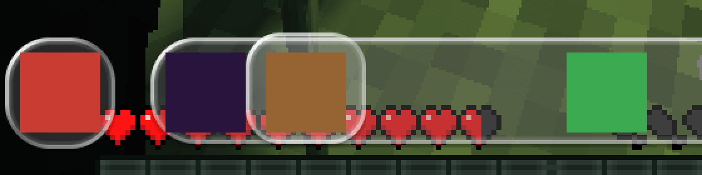
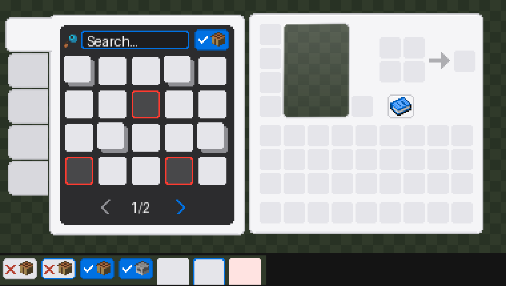

<p align="center"></p>

# macOS UI

Bring Apple's vibe to Minecraft's UI with a slick, minimalist style, while staying 100% vanilla.

A GUI resource pack for **Minecraft Java Edition 1.21.11**: roughly 60% Vanilla Minecraft, 40% Apple design. It keeps Minecraft's pixel-art identity and adds Apple's restraint: light surfaces, clear hierarchy, soft rounded geometry and a single blue accent.





> **Status:** early prototype (0.10, light theme). Restyled so far: survival and creative inventories, recipe book, text fields, Liquid Glass hotbar with Dock-style magnification, buttons, slot highlight and tooltips. A dark theme follows once the light theme is finished.

## Principles

- **Vanilla only.** No Fabric, Forge, NeoForge, OptiFine, Iris, shaders or mods. Plain resource-pack textures and metadata.
- **Gameplay untouched.** Slot positions, hitboxes and interactions are exactly vanilla.
- **Item models:** the hotbar magnification wraps every vanilla item model definition (`assets/minecraft/items/*.json`). Packs that change item *textures* still work. Packs that replace item *model definitions* will conflict.
- **Apple principles, not a macOS copy.** Material hierarchy, restraint, contrast and craft, translated into pixel art.
- **Performance first.** Small textures and stretched (not tiled) nine-slice centres.

## Install (testing builds)

The pack is still being designed and tested, so there are no releases yet. To try it:

1. Build it yourself (below).
2. Copy the zip from `dist/` (e.g. `macOS-UI-Light-0.10.zip`) into your `resourcepacks` folder (Prism Launcher: right-click the instance → Folder → `resourcepacks`).
3. Enable it in Options → Resource Packs.


## Build from source

Requires Python 3.10+ and Pillow (`pip install pillow`).

```bash
# 1. Extract the vanilla reference assets from your own Minecraft jar (one time)
python3 tools/extract_vanilla.py path/to/minecraft-1.21.11-client.jar

# 2. Build the pack into dist/
python3 tools/build.py
```

Prism Launcher keeps the jar at `<Prism data>/libraries/com/mojang/minecraft/1.21.11/minecraft-1.21.11-client.jar`.

All colours and radii live in [`design/tokens.json`](design/tokens.json). Change a token and rebuild; no texture is edited by hand.

## Repository layout

```
design/tokens.json        Design tokens: every colour and corner radius
design/logo/              Pack logo: original artwork (logo-source.png) and the native-pixel icon (logo-icon.png)
tools/extract_vanilla.py  Pulls vanilla GUI reference assets out of the client jar
tools/build.py            Generates the pack from tokens + vanilla geometry
docs/                     Feasibility study, theme plan, decisions log, testing checklist
docs/images/              Preview renders
reference/   (ignored)    Extracted Mojang assets: local only, never committed
dist/        (ignored)    Built test packs: local only
```

## Documentation

- [Feasibility, concepts and plan](docs/01-feasibility-and-concepts.md)
- [Light and dark themes](docs/02-light-and-dark-themes.md)
- [Decisions log](docs/decisions-log.md)
- [Testing checklist](docs/testing-checklist.md)
- [Vanilla 1.21.11 GUI sprite list](docs/vanilla-1.21.11-gui-sprites.tsv)
- [Changelog](CHANGELOG.md)

## License

Code and original artwork in this repository: [GPL-3.0](LICENSE).
Minecraft is a trademark of Mojang/Microsoft. This project contains no Mojang assets; vanilla files are only read locally from your own copy of the game. Not affiliated with Apple or Mojang.
