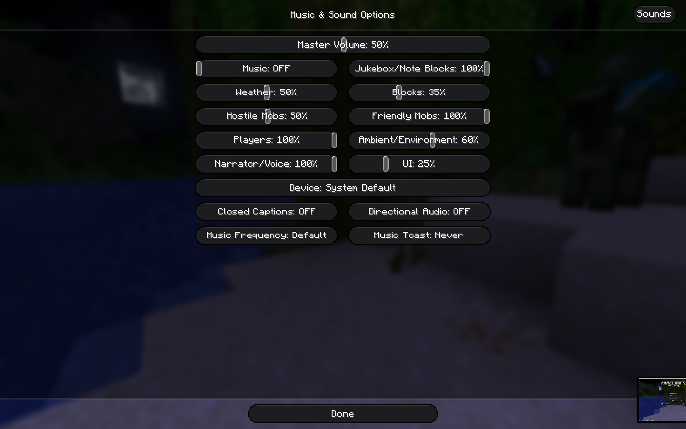
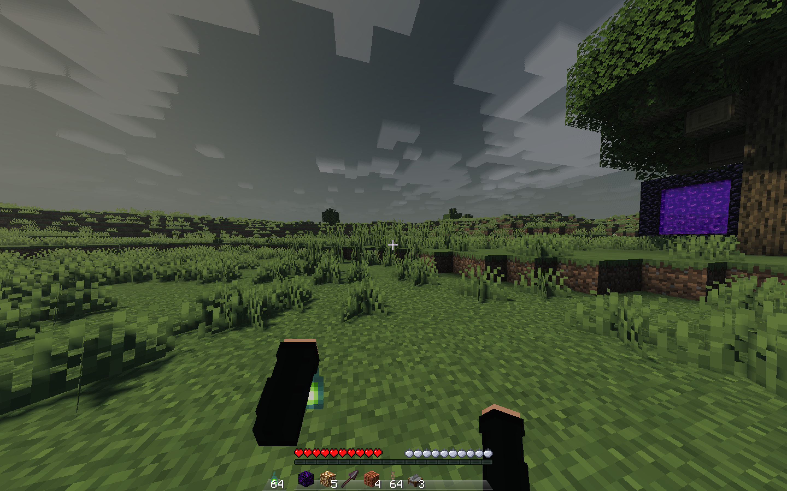

<p align="center"></p>

# macUI

Bring Apple's vibe to Minecraft's UI with a slick, minimalist style, while staying 100% vanilla.

A GUI resource pack for **Minecraft Java Edition 1.21.11**: roughly 60% Vanilla Minecraft, 40% Apple design. It keeps Minecraft's pixel-art identity and adds Apple's restraint: light surfaces, clear hierarchy, soft rounded geometry and restrained color accents.

> **Status:** early prototype (0.29, light theme). Includes light inventory and workstation screens, Liquid Glass shelf hotbar and marked XP/jump bars, Manrope numbers, silver apple food icons, buttons, sliders and tooltips. Magnification is included but off by default; the selection bubble is on by default. Shulker color matching is optional through OptiGUI. Latest changes still need in-game verification.

## Screenshots

User-provided gameplay and menu captures. These show a modded setup; other visual effects and mods visible in the images are not included in macUI.








### Shulker color preview

Generated texture preview, not an in-game capture. Color matching requires OptiGUI.


## Principles

- **Vanilla-compatible base.** Core styling works without mods or shaders. Respackopts adds settings; OptiGUI adds automatic shulker color matching.
- **Gameplay untouched.** Slot positions, hitboxes and interactions are exactly vanilla.
- **Interface focused.** Includes optional item magnification through item definitions and GUI model wrappers; other item-definition packs can conflict.
- **Apple principles, not a macOS copy.** Material hierarchy, restraint, contrast and craft, translated into pixel art.
- **Performance first.** Small textures and stretched (not tiled) nine-slice centres.

## Install (testing builds)

The pack is still being designed and tested, so there are no releases yet. To try it:

1. Build it yourself (below).
2. Copy the zip from `dist/` (e.g. `macUI-Light-0.29.zip`) into your `resourcepacks` folder (Prism Launcher: right-click the instance → Folder → `resourcepacks`).
3. Enable it in Options → Resource Packs.


## Magnification

Magnification is included in the main pack and **off by default**, including on plain vanilla. With Respackopts, choose 1.00× (off), 1.25×, 1.38× or 1.50× in the pack's Hotbar and HUD options. No separate add-on is needed.

The pack includes item definitions and GUI model wrappers for this option. Packs that replace item definitions can conflict; item texture packs still work. On plain vanilla the wrappers use 1.00× scale. With Respackopts and magnification off, the item overrides are filtered out. Enlarged selected items also appear in the inventory hotbar row.

## Optional: in-game settings (Respackopts)

The pack works on plain vanilla Minecraft. Players who also install the [Respackopts](https://modrinth.com/mod/respackopts) mod (Fabric/NeoForge, plus its LibJF dependency) get a settings button next to the pack in the resource pack screen:

| Setting | Default | Options |
|---|---|---|
| Magnify selected item | Off (1.00×) | Off / 1.25× / 1.38× / 1.50× |
| Glass bubble on selected slot | On | On / off |
| Hotbar style | Shelf (glass ledge) | Shelf (glass ledge the items sit on) / Dock (glass bar) |
| Hotbar opacity | Clear | Clear / frosted / dark / solid |
| Glass outline on hotbar | Off | On / off |
| Food icons | Silver apples | Silver apples / vanilla |
| Button shape | Pill | Pill / rounded rectangle (buttons and sliders) |
| Glass behind player model | On | On / off (opaque tile) |

Without the mod, Minecraft ignores `respackopts.json5` and the `.rpo` files, and the defaults above apply. Alternative textures live in `assets/macui/alt/`, which vanilla never loads.

## Build from source

Requires Python 3.10+, Pillow with FreeType support, and NumPy (`pip install pillow numpy`).

```bash
# 1. Extract the vanilla reference assets from your own Minecraft jar (one time)
python3 tools/extract_vanilla.py path/to/minecraft-1.21.11-client.jar

# 2. Build the pack into dist/
python3 tools/build.py
```

Prism Launcher keeps the jar at `<Prism data>/libraries/com/mojang/minecraft/1.21.11/minecraft-1.21.11-client.jar`.

All colours and radii live in [`design/tokens.json`](design/tokens.json). Change a token and rebuild; no texture is edited by hand.

## Repository layout

```
design/tokens.json        Design tokens: every colour and corner radius
design/logo/              Pack logo: original artwork (logo-source.png) and the native-pixel icon (logo-icon.png)
tools/extract_vanilla.py  Pulls vanilla GUI reference assets out of the client jar
tools/build.py            Generates the pack from tokens + vanilla geometry
docs/                     Feasibility study, theme plan, decisions log, testing checklist
docs/images/              Gameplay screenshots and generated shulker preview
reference/   (ignored)    Extracted Mojang assets: local only, never committed
dist/        (ignored)    Built test packs: local only
```

## Development history

Prototype milestones, oldest first. These are development iterations, not individually published releases. In-game testing of the latest changes is still pending.

| Prototype | What changed |
|---|---|
| 0.1 | First inventory, hotbar, buttons, hover highlights and tooltips. |
| 0.2 | Flat rounded slot tiles; fixed slot corner dots and pill button borders. |
| 0.3 | Translucent player preview with glass edges. |
| 0.4 | Dock hotbar, offhand styling and selected-slot indicator dot. |
| 0.5 | Shared Liquid Glass material; raised selection bubble and glass player well. |
| 0.6 | Pill buttons chosen as the main style. |
| 0.7 | Creative inventory, tabs, scrollbar and blue recipe-book button. |
| 0.8 | Recipe book, search fields, HD glass and 1.25× selected-item magnification. |
| 0.8.1 | Hotbar reduced to 2× to fix missing textures. |
| 0.9 | New logo; 1.50× magnification; bubble removed; versioned ZIP names. |
| 0.10 | Magnification reduced to 1.38×; softer glass without the white rim. |
| 0.11 | Silver apple food icons. |
| 0.12 | Blue Hunger-effect food icons. |
| 0.13 | Graphite sliders with rounded handles and blue hover state. |
| 0.14 | Optional Respackopts settings; English and Spanish labels. |
| 0.15 | Shelf/Dock styles, opacity choices, bubble toggle and magnification sizes. |
| 0.16 | Softer shelf lip and front-edge lighting. |
| 0.17 | Shelf becomes the default hotbar and offhand style. |
| 0.18 | Magnification slider experiment with prebuilt sizes. |
| 0.19 | Magnification simplified to fixed size choices. |
| 0.20 | HD Liquid Glass slider handles. |
| 0.21 | Project renamed to macUI; new pack namespace and settings ID. |
| 0.22 | Magnification moved into a separate add-on; main pack became GUI-only. |
| 0.23 | Initial glass XP, horse jump and locator tracks. Early ZIPs were revised during development; superseded by 0.24. |
| 0.24 | Marked XP/jump bars; final two jump segments red; bubble restored; Magnify reintegrated and off by default. |
| 0.25 | Manrope semibold digits 0–9; vanilla letters and symbols retained. |
| 0.26 | Tighter selection bubble with room for stack counts. |
| 0.27 | Inventory styling across remaining containers, workstations, mount inventories and related controls. |
| 0.28 | Smaller slot tiles and inset loom/stonecutter recipe selections. |
| 0.29 | Optional OptiGUI shulker colors: all 16 dyes plus undyed, with vanilla fallback. |

See [CHANGELOG.md](CHANGELOG.md) for details.

## Documentation

- [Feasibility, concepts and plan](docs/01-feasibility-and-concepts.md)
- [Light and dark themes](docs/02-light-and-dark-themes.md)
- [Decisions log](docs/decisions-log.md)
- [Testing checklist](docs/testing-checklist.md)
- [Vanilla 1.21.11 GUI sprite list](docs/vanilla-1.21.11-gui-sprites.tsv)
- [Changelog](CHANGELOG.md)

## License

Code and original artwork in this repository: [GPL-3.0](LICENSE).
Minecraft is a trademark of Mojang/Microsoft. Extracted vanilla reference assets and generated packs are not committed. Screenshots show Minecraft gameplay; generated previews show the pack styling. Not affiliated with Apple or Mojang.

Numbers 0–9 use Manrope semibold; other characters retain the vanilla font. Manrope is distributed under the SIL Open Font License; see `design/fonts/Manrope-OFL.txt`.

## Optional: colored shulker inventories

With OptiGUI installed, shulker inventories automatically use soft tints matching all 16 dye colors plus undyed purple. Included in the main pack; no extra resource pack needed. Without OptiGUI, shulkers keep the standard light panel. Rules are included for OptiGUI 2 (INI) and 3 (JSON); live compatibility testing is pending.
